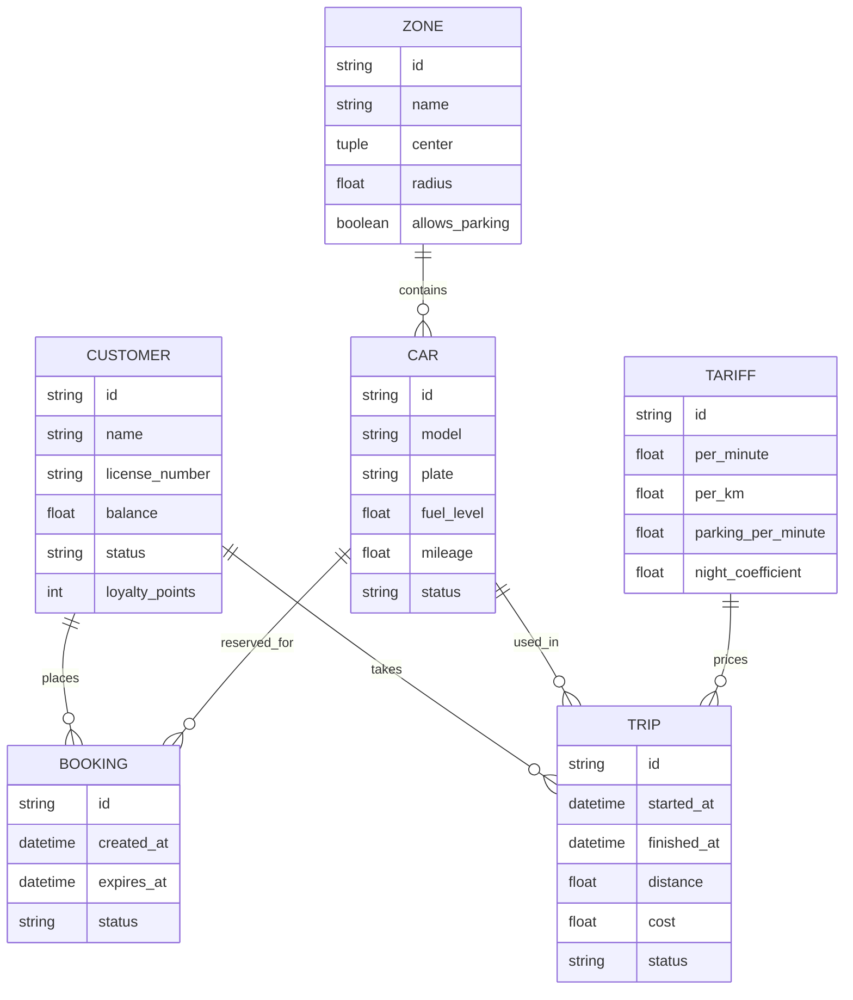

# Анализ исходного состояния

## Назначение и предметная область

Репозиторий содержит стартовую («до») версию учебного приложения для
консольной демонстрации каршеринга. При запуске создаётся сервис с клиентами,
автомобилями, зонами, тарифами, бронями и поездками в памяти процесса.
Пользовательского ввода, базы данных и файлового хранилища нет: `main.py`
последовательно демонстрирует сценарии, а тесты фиксируют их наблюдаемое
поведение.

Код намеренно построен в стиле императивного ООП: сущности представлены
изменяемыми объектами, сервис организует операции над ними, а модельные методы
также могут самостоятельно читать часы, глобальную конфигурацию и генератор
случайных чисел. Например, завершение поездки совмещает тарифный расчёт,
применение скидок, изменение объектов, списание средств и печать чека. Этот
исходный вариант служит материалом для последующего выделения вычислений из
действий и прояснения входов и выходов.

## ER-диаграмма

Связи показывают навигационные ссылки между объектами в модели. `Customer`
хранит список броней и поездок; поездки также включены в списки автомобиля и
тарифа; зона хранит список своих автомобилей. Каждая поездка ссылается на
одного клиента, автомобиль и тариф, каждая бронь — на одного клиента и
автомобиль.

## Граф вызовов методов

Граф показывает основной путь выполнения в приложении и ключевые внутренние
вызовы, связанные с рассматриваемыми действиями. CLI вызывает операции сервиса;
сервис загружает объекты из своих словарей, а затем часть операций делегирует
методам моделей. Пунктиром обозначены чтение внешнего для бизнес-операции
состояния или непосредственный побочный эффект.

```mermaid
flowchart TD
    CLI["main() / _run_scenario()"]
    CLI --> REG["register_customer()"]
    CLI --> FIND["find_nearest_cars()"]
    CLI --> BOOK["create_booking()"]
    CLI --> CANCEL["cancel_booking()"]
    CLI --> START["start_trip()"]
    CLI --> QUOTE["calculate_trip_cost()"]
    CLI --> FINISH["finish_trip()"]
    CLI --> MONEY["top_up_balance() / charge_balance()"]
    CLI --> DEBT["block_debtors()"]
    CLI --> TRANSFER["transfer_car()"]
    CLI --> STATEMENT["monthly_statement()"]

    CANCEL --> GETBOOK["_booking()"]
    CANCEL --> BCANCEL["Booking.cancel()"]
    BCANCEL --> DEBIT1["Customer.debit()"]

    START --> GETCUSTOMER["_customer()"]
    START --> GETCAR["_car()"]
    START --> GETTARIFF["_tariff()"]
    START --> NEWTRIP["создание Trip"]

    QUOTE --> GETTRIP1["_trip()"]
    QUOTE --> RATE1["Tariff.calc_day_cost() / calc_night_cost()"]
    QUOTE --> DEMAND1["_demand_coefficient()"]
    QUOTE -.-> NOW1["datetime.now()"]
    QUOTE -.-> RNG1["random.uniform()"]
    QUOTE -.-> CONFIG1["глобальный config"]

    FINISH --> GETTRIP2["_trip()"]
    FINISH --> ZONE["_find_zone() / Zone.contains()"]
    FINISH --> TRIPFINISH["Trip.finish()"]
    TRIPFINISH --> RATE2["Tariff.calc_day_cost() / calc_night_cost()"]
    TRIPFINISH --> DEMAND2["Trip._demand_coefficient()"]
    TRIPFINISH --> DISCOUNT["Trip._apply_discounts()"]
    TRIPFINISH --> DEBIT2["Customer.debit()"]
    TRIPFINISH -.-> CLOCK["datetime.now()"]
    TRIPFINISH -.-> PRINT["print(чек)"]
    TRIPFINISH -.-> COUNTER["Trip.total_finished"]
    FINISH -.-> FINE["Customer.debit() + print(штраф)"]

    MONEY --> DEBIT3["Customer.debit() / Customer.credit()"]
    STATEMENT --> HISTORY["Customer.trips"]
```

## Неявные входы и выходы ключевых методов

В таблице «неявный» означает, что значение или эффект не выражены явным
аргументом/результатом метода: они получаются из глобального состояния,
системных часов, связанных объектов, генератора случайных чисел или выводятся
наружу через изменение состояния и печать. Имена соответствуют текущей
реализации; там, где запрошенная операция не выделена отдельным методом,
указано её фактическое место.

| Метод | Неявные входы | Неявные выходы | Почему это действие |
|---|---|---|---|
| `CarsharingService.finish_trip()` | `self.trips` (поиск поездки); `self.zones` и геометрия зон; связанные клиент, автомобиль и тариф; `datetime.now()`; глобальный `config`; случайный коэффициент спроса через `random.uniform()` внутри `Trip.finish()`; накопленные баллы клиента | Изменение `Trip` (время окончания, расстояние, стоимость, статус); изменение баланса, статуса и баллов `Customer`; изменение пробега, топлива, статуса и зоны `Car`; `Trip.total_finished`; чек или сообщение о штрафе в stdout; возвращаемая сумма | Оркестрирует завершение и смешивает расчёты с записью состояния связанных сущностей, списанием денег и печатью. При разрешённой парковке делегирует большую часть этой работы в `Trip.finish()`. |
| `CarsharingService.cancel_booking()` / `Booking.cancel()` | `self.bookings`; текущие системные часы внутри `Booking.cancel()`; глобальные `cancellation_free_minutes` и `cancellation_fee`; ссылки брони на автомобиль и клиента, а также их текущее состояние | Статус брони и машины; баланс/статус клиента при комиссии; результат-комиссия; `ValueError`, если бронь неактивна или истекла | Отмена не возвращает описание результата, а непосредственно изменяет несколько объектов. Метод сам читает часы и сигнализирует об ошибке исключением. |
| `CarsharingService.calculate_trip_cost()` (расчёт стоимости) | `self.trips`; время `datetime.now()`, если `at` не передано; глобальные коэффициенты ночного тарифа и спроса; состояние тарифа и баллов клиента; состояние RNG через `random.uniform()` | Число-оценка стоимости; также продвигается состояние глобального генератора случайных чисел. Состояние сущностей поездки не изменяется | Возвращает число, но вычисление зависит от поиска сущности, скрытого времени, конфигурации и случайности. Поэтому результат не является функцией только объявленных параметров. |
| `CarsharingService.start_trip()` | Словари клиентов, автомобилей и тарифов; текущее состояние клиента, машины и брони; `datetime.now()`; внутренний счётчик ID. Для `economy` тариф лениво создаётся, если его ещё нет | Новая поездка и изменение словарей сервиса; изменение статуса машины и брони; добавление поездки в историю клиента, машины и тарифа; продвижение счётчика ID; возможное создание тарифа в `self.tariffs` | Создаёт и регистрирует сущность, меняет состояние объектов и коллекций, а не просто вычисляет значение. |
| `Trip._apply_discounts()` (применение промокода и баллов; в `calculate_trip_cost()` часть логики продублирована) | `self.started_at`; глобальный `config`; связанные клиент и его текущие `loyalty_points`; аргументы кода, режима лояльности и суммы | Скорректированная сумма; при использовании баллов изменяется `Customer.loyalty_points`, затем начисляются баллы за остаточную стоимость | Несмотря на возвращаемую сумму, метод также меняет состояние клиента. Дополнительно правила скидок не едины: расчётная оценка в сервисе повторяет часть условий отдельно. |
| `charge_fine` (отдельного метода с таким именем нет; ветка штрафа в `CarsharingService.finish_trip()`) | Точка парковки из аргумента; словарь зон и их границы/разрешение парковки; глобальный `config.parking_fine`; связанная поездка, машина и клиент; системные часы | Списание штрафа и, возможно, блокировка клиента; закрытие поездки; запись времени, расстояния и стоимости; освобождение машины и обновление зоны; печать сообщения о штрафе; возврат штрафа | Это ветвь действия `finish_trip()`: она применяет бизнес-правило парковки и необратимо меняет состояние вместо того, чтобы отдельно вычислить результат проверки и явно передать его эффектам. |

### Что важно при переходе к следующему этапу

- Отделить вычислимые результаты (тариф, длительность, скидка, сумма штрафа)
  от команд, которые меняют состояние и выполняют ввод/вывод.
- Передавать время, коэффициент спроса и параметры правил явно, чтобы тесты и
  сценарии не зависели от часов, RNG и глобального `config`.
- Сделать чтение зависимостей явным и возвращать результаты операций, которые
  описывают изменения, вместо скрытой модификации множества объектов.
- Сохранить зафиксированное характеристическими тестами наблюдаемое поведение
  при изменении внутренней структуры.
